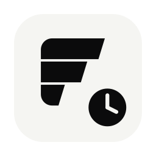
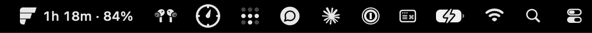
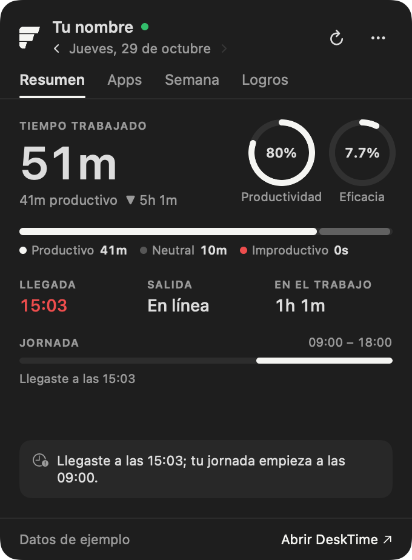
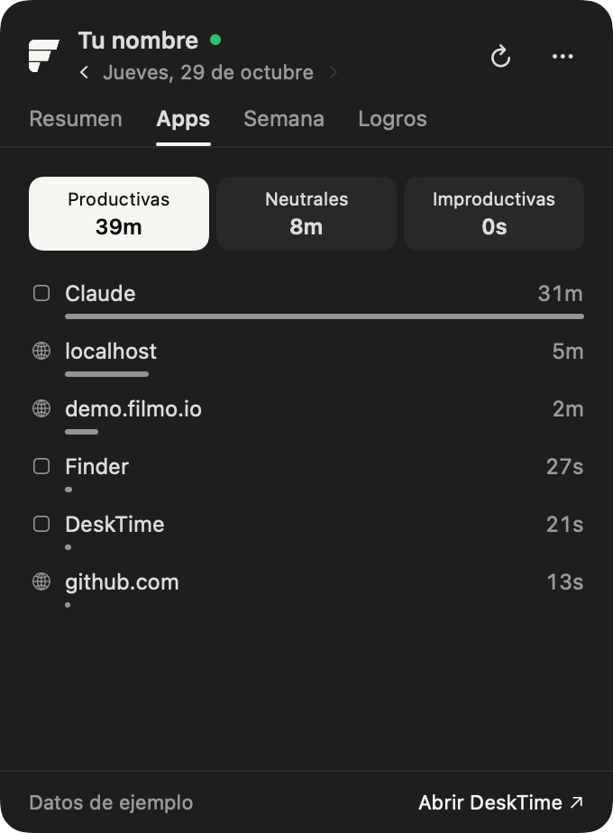
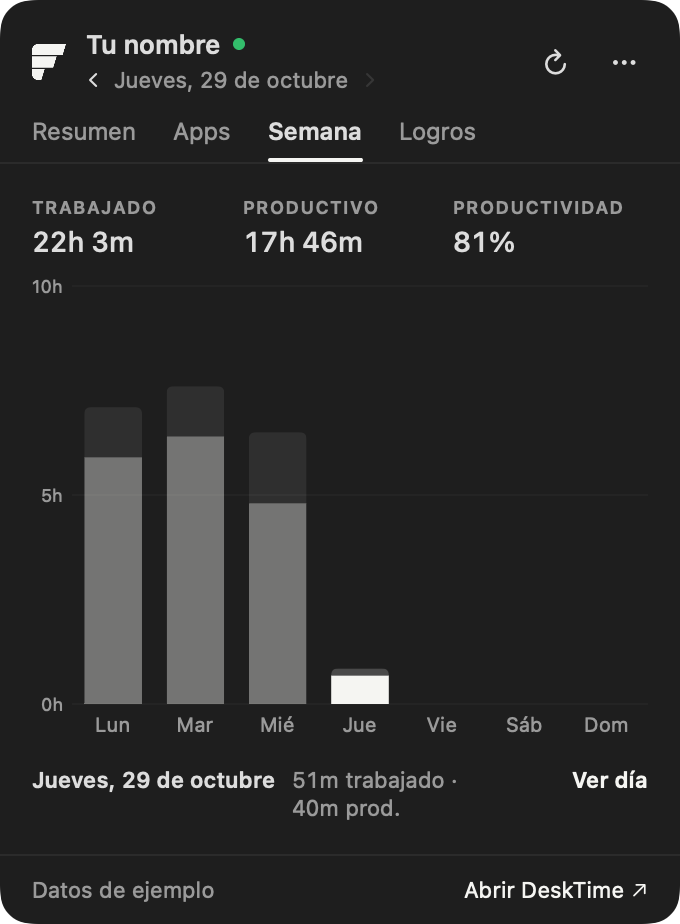
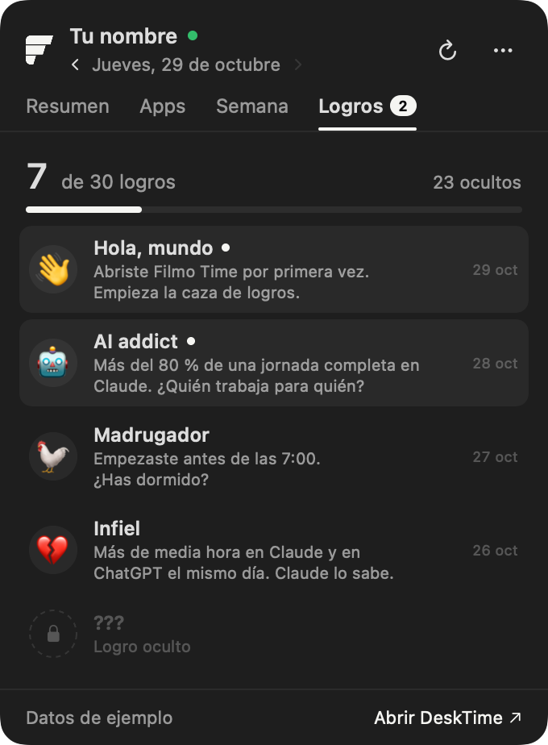
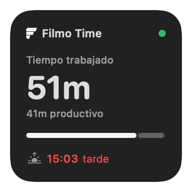
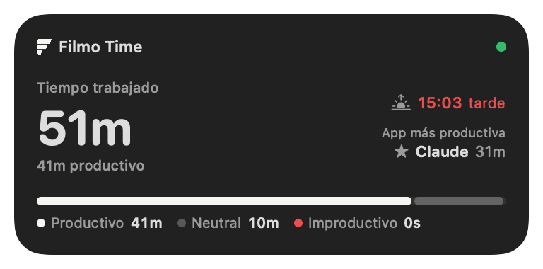
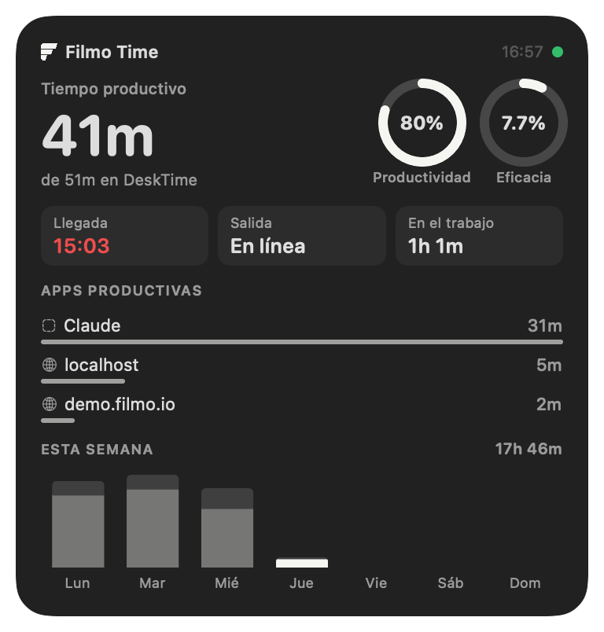
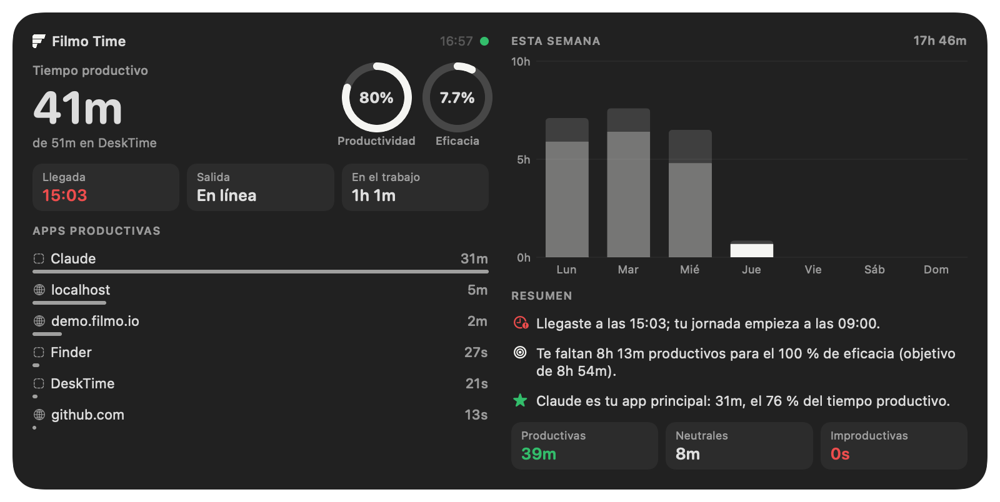

<div align="center">



# Filmo Time

**Tu DeskTime de un vistazo: en la barra de menús y como widget del escritorio de macOS.**

[](https://github.com/imelero-filmo/filmo-time/releases/latest/download/Filmo-Time.dmg)

macOS 14 o posterior · Mac con Apple Silicon · Gratis

</div>

---

## Qué es

Filmo Time lee tus datos de [DeskTime](https://desktime.com) y te los enseña sin abrir el navegador:

- **En la barra de menús:** el tiempo que llevas trabajado hoy y cuánto de él ha sido productivo. Un clic abre el resumen.
- **En el escritorio:** un widget en cuatro tamaños que se actualiza solo.

<p align="center"><br><sub>Siempre visible en la barra de menús</sub></p>

<table>
<tr>
<td align="center"><br><sub><b>Resumen</b> del día</sub></td>
<td align="center"><br><sub><b>Apps</b> productivas, neutrales e improductivas</sub></td>
<td align="center"><br><sub><b>Semana</b> día a día</sub></td>
</tr>
</table>

### 🏆 Logros

Hay **30 logros ocultos**. No sabrás cuáles son hasta que los consigas: cuando desbloqueas uno, te llega una notificación y aparece en la pestaña **Logros**. Algunos te harán sentir orgulloso. Otros, no tanto.

<p align="center"></p>

> Los logros que dependen de un porcentaje de la jornada solo cuentan en días de **7 horas trabajadas o más**.

### Widgets

<table>
<tr>
<td align="center"><br><sub>Pequeño</sub></td>
<td align="center"><br><sub>Mediano</sub></td>
</tr>
<tr>
<td align="center" colspan="2"><br><sub>Grande</sub></td>
</tr>
<tr>
<td align="center" colspan="2"><br><sub>Extragrande</sub></td>
</tr>
</table>

---

## Instalación (2 minutos)

### 1. Descarga e instala

1. Descarga **[Filmo-Time.dmg](https://github.com/imelero-filmo/filmo-time/releases/latest/download/Filmo-Time.dmg)**.
2. Ábrelo y arrastra **Filmo Time** a la carpeta **Aplicaciones**.

### 2. Permite que se abra (solo la primera vez)

La app no viene de la App Store, así que macOS la bloquea la primera vez:

1. Abre **Filmo Time** desde Aplicaciones. Aparece un aviso: pulsa **Hecho**.
2. Ve a **Ajustes del Sistema → Privacidad y seguridad**.
3. Baja hasta **Seguridad** y pulsa **Abrir igualmente** junto a «Filmo Time».
4. Confirma con tu contraseña.

### 3. Conecta tu cuenta de DeskTime

1. Entra en **[desktime.com/app/api](https://desktime.com/app/api)** con tu cuenta.
2. Pulsa el botón para **generar tu API key** y cópiala.
3. Pégala en la ventana que te abre Filmo Time y pulsa **Guardar**.

> Cada persona usa **su propia** API key. Se guarda solo en tu Mac.

### 4. Añade el widget al escritorio

1. Haz **clic derecho** en el escritorio → **Editar widgets…**
2. Busca **Filmo Time**.
3. Elige el tamaño y arrástralo al escritorio. Pulsa **Hecho**.

### 5. Recomendado: que arranque solo

Clic derecho en el icono **F** de la barra de menús → activa **Abrir al iniciar sesión**.

---

## Cómo se usa

| Dónde | Qué hacer |
|---|---|
| Icono **F** en la barra de menús | **Clic:** abre el resumen · **Clic derecho:** menú |
| Flechas **‹ ›** junto a la fecha | Ver días anteriores |
| Pestaña **Semana** | Pasa el ratón por una barra para ver el día; haz clic para abrirlo |
| Widget | Haz clic para abrir tu DeskTime en el navegador |

**Actualización de datos:** cada 5 minutos. La barra de menús, el desplegable y el widget usan la misma consulta, así que siempre muestran lo mismo.

## Qué significa cada dato

| Dato | Significado |
|---|---|
| **Tiempo trabajado** | Todo el tiempo con actividad en el ordenador, sea en apps productivas, neutrales o improductivas. Es el dato principal. |
| **Productivo · Neutral · Improductivo** | Cómo se reparte tu tiempo trabajado según el tipo de app. Que algo sea neutral (correo, ajustes…) no significa que no hayas trabajado. |
| **Tiempo productivo** | La parte del tiempo trabajado en apps y webs que DeskTime marca como productivas. |
| **Productividad** | Qué parte de tu tiempo frente al ordenador fue productiva. |
| **Eficacia** | Tu tiempo productivo comparado con tu jornada objetivo. Llega al 100 % al completar la jornada. |
| **Llegada** | Primera actividad del día. En rojo si es después del inicio de tu jornada. |
| **Jornada** | Tu horario de DeskTime y cuánto queda. |

---

## Preguntas frecuentes

<details>
<summary><b>No aparece en la galería de widgets</b></summary>

Abre Filmo Time una vez desde Aplicaciones, cierra la galería y vuelve a abrirla. Si sigue sin salir, reinicia el Mac.
</details>

<details>
<summary><b>Cómo cambio mi API key</b></summary>

Clic derecho en el icono **F** de la barra de menús → **Configurar API key…**
</details>

<details>
<summary><b>Cómo se actualiza</b></summary>

Sola. Filmo Time comprueba una vez al día si hay una versión nueva y te pregunta si quieres instalarla: pulsa **Actualizar ahora** y se reinicia con la nueva. También puedes buscarla a mano: clic derecho en el icono **F** → **Buscar actualizaciones…** Tu API key y tus widgets se conservan.
</details>

<details>
<summary><b>Cómo lo desinstalo</b></summary>

Clic derecho en el icono **F** → **Salir**, y borra **Filmo Time** de Aplicaciones.
</details>

<details>
<summary><b>Privacidad</b></summary>

Tu API key se guarda en un archivo de tu Mac que solo puede leer tu usuario (`~/Library/Application Support/DeskTimeWidget/apikey`). La app solo se conecta a `desktime.com`. No envía datos a ningún otro sitio.
</details>

---

## Para desarrolladores

Compilar requiere Xcode (o sus herramientas de línea de comandos) y un certificado **Apple Development**.

```bash
./build.sh             # compila
./build.sh --install   # compila, instala en /Applications y abre la app
./build.sh --dmg       # genera dist/Filmo-Time.dmg para publicar
```

### Publicar una versión

```bash
VERSION=1.1 ./build.sh --dmg
gh release create v1.1 dist/Filmo-Time.dmg --title "Filmo Time 1.1" --notes "Qué cambia"
```

- La etiqueta tiene que ser `v` + la misma versión (`v1.1`) y el archivo adjunto llamarse `Filmo-Time.dmg`.
- Las apps instaladas lo detectan solas (una vez al día) y ofrecen actualizar. Solo instalan versiones firmadas por el mismo certificado.
- El enlace de descarga del README apunta siempre a la última release.

| Carpeta | Contenido |
|---|---|
| `App/` | App de la barra de menús (SwiftUI) |
| `Widget/` | Widget del escritorio (WidgetKit) |
| `Shared/` | API de DeskTime, modelo y formato, compartidos |
| `Resources/` | Marca Filmo (SVG) e instrucciones del DMG |

<div align="center"><sub>Hecho en Filmo · No afiliado a DeskTime</sub></div>
